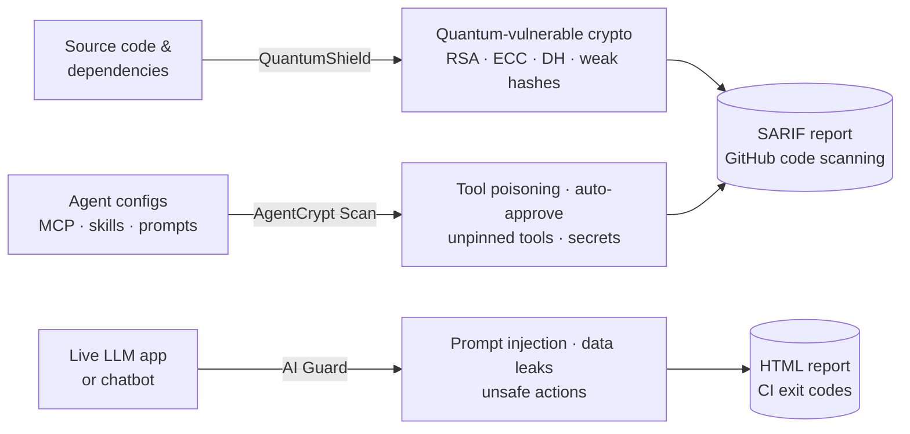

# Komarapu Jordan Ephraim

### AI Security · Post-Quantum Readiness · Full-Stack Development

I help startups ship AI products and software that are **secure before they go live**:
quantum-vulnerable crypto found, AI agents tested, and products built properly.

**Remote · working with teams in the US, UK, Europe and the Middle East**

---

## 🛡️ The Security Toolkit

Three open-source tools that cover an AI product from code to production. Each one works on its own and plugs into CI with SARIF / exit codes.

| Tool | Stage | What it finds | Status |
|---|---|---|---|
| [**QuantumShield**](https://github.com/komarapujordanephraim-creator/quantumshield) | Code | RSA, ECC, DH and weak crypto in code and dependencies, committed keys, with post-quantum migration hints. [Live page](https://komarapujordanephraim-creator.github.io/quantumshield/) |  |
| [**AgentCrypt Scan**](https://github.com/komarapujordanephraim-creator/agentcrypt-scan) | Config | MCP and agent-skill risks: tool-poisoning text, hidden Unicode, auto-approve, unpinned `npx` tools, insecure HTTP servers, secrets. GitHub Action included. |  |
| [**AI Guard**](https://github.com/komarapujordanephraim-creator/ai-guard) | Runtime | Prompt injection, system-prompt and data leaks, unsafe tool actions. 10 probes, HTML report, permission-gated live testing. |  |

**Applied example:** [**InboxPilot**](https://github.com/komarapujordanephraim-creator/inboxpilot) puts these ideas into a working AI automation: it sorts WhatsApp, email and chat messages, answers safe ones, and holds refunds, complaints and prompt-injection attempts for human approval.

---

## 🚀 Products I Build

Every project has tests, a clear README and an honest list of limits.

| Area | Project | Highlights |
|---|---|---|
| SaaS | [saas-starter](https://github.com/komarapujordanephraim-creator/saas-starter) | Multi-tenant Django: workspaces, invites, roles, plan limits, billing flow |
| CRM | [smallbiz-crm](https://github.com/komarapujordanephraim-creator/smallbiz-crm) | Contacts, deal pipeline, activity log, per-user data isolation |
| E-commerce | [shopkit](https://github.com/komarapujordanephraim-creator/shopkit) | Catalogue, cart, stock-safe checkout, price snapshots, staff order flow |
| ERP | [mini-erp](https://github.com/komarapujordanephraim-creator/mini-erp) | Stock ledger, purchase orders, invoices, no overselling |
| Mobile | [bookeasy](https://github.com/komarapujordanephraim-creator/bookeasy) | React Native (Expo, TypeScript) booking app, Jest tests |
| AI automation | [inboxpilot](https://github.com/komarapujordanephraim-creator/inboxpilot) | Multi-channel inbox with human approval, audit log, signed webhooks |

## 📊 Data & ML

| Project | What it shows |
|---|---|
| [phishing-url-detector](https://github.com/komarapujordanephraim-creator/phishing-url-detector) | Security ML with domain-grouped validation and honest baselines. [Live page](https://komarapujordanephraim-creator.github.io/phishing-url-detector/) |
| [us-jobs-dashboard](https://github.com/komarapujordanephraim-creator/us-jobs-dashboard) | BLS data analysis with an interactive dashboard. [Live dashboard](https://komarapujordanephraim-creator.github.io/us-jobs-dashboard/dashboard/) |
| [ml-tumor-classifier](https://github.com/komarapujordanephraim-creator/ml-tumor-classifier) | Model comparison with cross-validation and stated limitations |

---

## 🤝 How I Can Help Your Team

| Service | Typical scope |
|---|---|
| **Post-quantum readiness check** | Crypto inventory of your codebase, risk ranking and a migration plan |
| **AI agent & chatbot security test** | 40–50 attack conversations against your bot or agent, report with exact chats and fixes |
| **Secure product development** | SaaS, CRM, e-commerce, mobile and AI automation, built with tests from day one |

Fixed scope, written updates and milestone-based delivery.

## 🧰 Tech

**Building something with AI or worried about quantum-safe crypto? [Let's talk.](mailto:komarapujordanephraim@gmail.com)**

